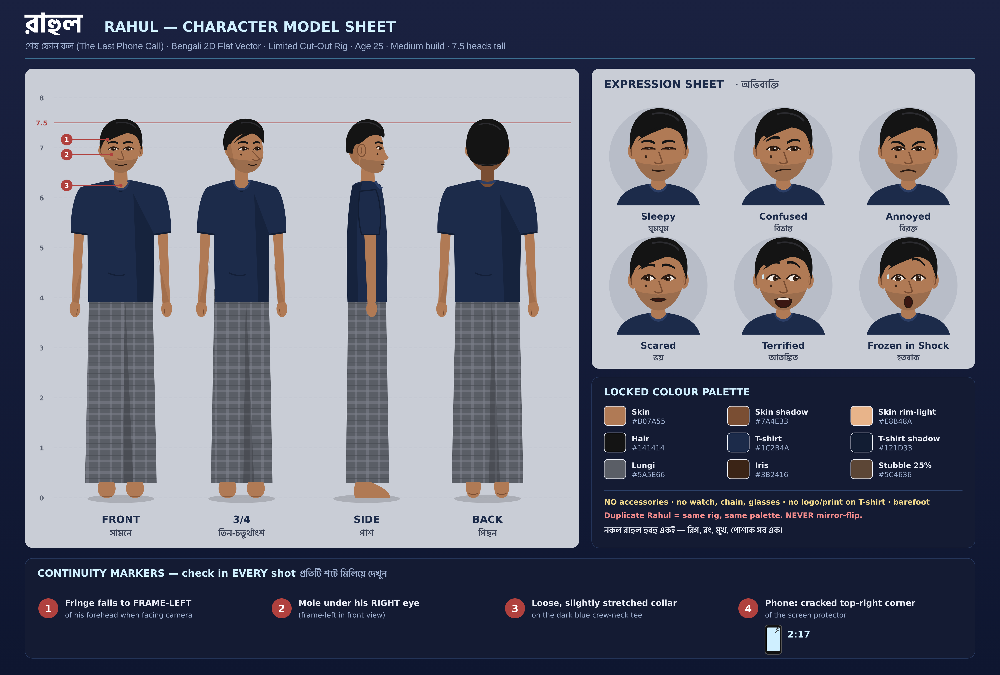
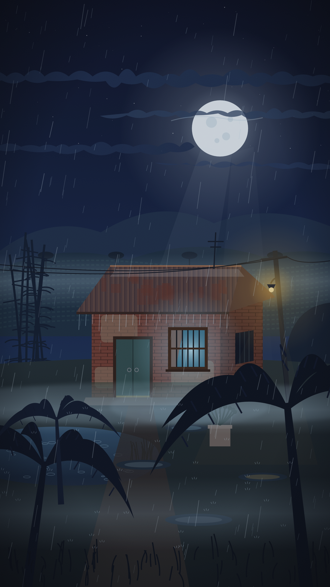
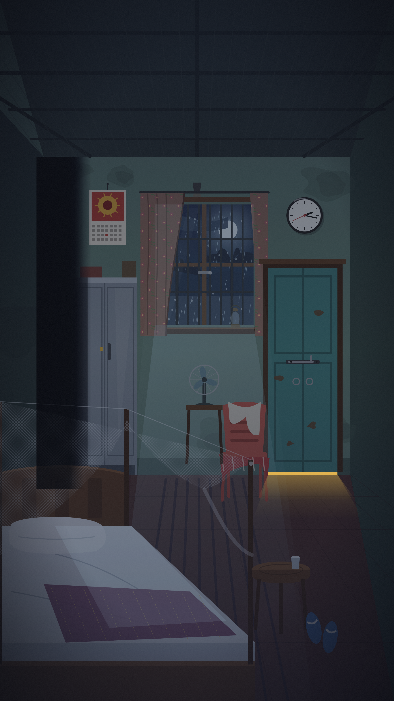

# শেষ ফোন কল (The Last Phone Call)
### A 90-Second Bengali Psychological Suspense / Supernatural Animated Reel
**Production-Ready Screenplay, Shot List & AI Generation Bible**

---

## 0. PRODUCTION SPECIFICATIONS

| Item | Specification |
|---|---|
| Title | শেষ ফোন কল (The Last Phone Call) |
| Runtime | **Exactly 90.0 seconds** (00:00 – 01:30) |
| Shots | 17 shots |
| Aspect ratio | Vertical **9:16** — 1080 × 1920 px |
| Frame rate | 24 fps (animate on 2s for cut-out limbs, on 1s for camera moves, rain and fog) |
| Platforms | Instagram Reels, Facebook Reels, YouTube Shorts |
| Language | Natural conversational West Bengali (Kolkata/Siliguri everyday speech) |
| Genre | Psychological suspense + supernatural mystery |
| Animation style | Bengali 2D Flat Vector Storytelling Cartoon — Limited Cut-Out Animation, cinematic lighting |
| Safe zones | Keep faces & subtitles inside the central 1080 × 1420 area; top 220 px and bottom 300 px stay clear of key action (platform UI overlap) |
| Subtitle position | Lower-middle, 62–70% of frame height, above the platform caption zone |
| Audio master | -14 LUFS integrated (Reels/Shorts loudness), dialogue peak -6 dBFS, stereo |

---

## 1. LOGLINE

রাত ঠিক ২টো ১৭-য় রাহুলের ফোনে কল আসে — তারই নিজের নম্বর থেকে। ফোনের ওপারের লোকটা বলে, সে নাকি দশ মিনিট পরের রাহুল। জানলার বাইরে, দরজার ওপারে, আর ঘরের ভেতরে — একই মুখ, একই গলা। কিন্তু আসল রাহুল কে?

*At exactly 2:17 AM, Rahul gets a call from his own number. The caller says he is Rahul from ten minutes in the future. Outside the window, behind the door, inside the room: the same face, the same voice. So which one is the real Rahul?*

---

## 2. CHARACTER BIBLE: RAHUL (LOCKED DESIGN)

> **Rule:** There is ONE character design. Every version of Rahul (the Rahul on the bed, the voice on the phone, the voice behind the door, the one behind him) uses **the same rig, the same model sheet and the same voice actor.** No variant costumes, no "evil" recolours, no glowing eyes. The horror comes from them being *identical*.

### 2.1 Fixed Visual Attributes

| Attribute | Locked Value |
|---|---|
| Age | 25 |
| Ethnicity | Bengali (West Bengal) |
| Build | Medium build, average height (≈ 5'7" / 170 cm), **7.5 heads tall** in the model sheet |
| Skin tone | Warm wheatish-brown, base `#B07A55`, shadow `#7A4E33`, rim-light `#E8B48A` |
| Face shape | Oval, soft jawline, slight stubble shadow (`#5C4636` at 25% opacity) |
| Eyes | Almond-shaped, dark brown iris `#3B2416`, thick natural eyebrows |
| Nose | Medium, slightly rounded tip |
| Lips | Medium, neutral |
| Hair | **Short black hair** `#141414`, neat side-swept fringe falling slightly to the left of his forehead, short sides, no gel shine |
| Clothing (top) | **Plain dark blue crew-neck T-shirt** `#1C2B4A`, half sleeves, no logo, no print |
| Clothing (bottom) | Grey checked cotton lungi/pyjama `#5A5E66` (only visible in wide shots) |
| Feet | Barefoot |
| Accessories | **None.** No watch, no chain, no glasses. Phone only. |
| Phone | Black budget Android smartphone, cracked top-right corner of screen protector (continuity marker) |

### 2.2 Continuity Markers (must match in EVERY shot, including the duplicate)
1. Fringe falls to **frame-left** of his forehead when he faces camera.
2. Small dark mole under the **right** eye.
3. T-shirt neckline slightly stretched/loose at the collar.
4. Cracked top-right corner on the phone screen protector.

> The duplicate Rahul in Shot 16 shares **all four** markers. There is no mirror-flip: the mole stays under the right eye. This matters because it rules out a "reflection" reading.

### 2.3 Voice Bible

| Voice | Who | Treatment |
|---|---|---|
| **V1: Rahul (live)** | Rahul in the room | Natural, dry, close mic. Mid-low baritone, slight Siliguri softness, gets breathy as fear rises. |
| **V2: Caller "Future Rahul"** | Same actor, same take session | Phone band-pass EQ (300 Hz – 3.4 kHz), light digital crackle, whispering urgency. **In Shot 15 the filter is gradually removed** and the voice moves from the phone into the room (see §7). |
| **V3: Door voice** | Same actor | Muffled through wood (low-pass ~1.8 kHz), small room reverb, **unnaturally calm and flat**, with a slight 30 ms delay doubling so it feels "almost" right. |

All three must be the **same actor**. Do not pitch-shift.

### 2.4 Model Sheet



The vector source is [`rahul_model_sheet.svg`](./rahul_model_sheet.svg). Use the PNG as `REF_RAHUL_FRONT` / `REF_RAHUL_34` reference input, or import the SVG into Illustrator / Moho / After Effects to build the cut-out rig.

### 2.5 Master Character Reference Prompt (generate the model sheet first, then lock it)

```
Character model sheet, Bengali 2D flat vector cartoon, limited cut-out animation style,
RAHUL: 25-year-old Bengali man, medium build, 7.5 heads tall, warm wheatish-brown skin,
oval face, soft jawline, light stubble shadow, almond dark-brown eyes, thick natural eyebrows,
small dark mole under his right eye, short black hair with a neat side-swept fringe falling
to the left of his forehead, plain dark blue crew-neck half-sleeve T-shirt (#1C2B4A) with
slightly loose collar, grey checked cotton lungi, barefoot, no accessories.
Turnaround: front, 3/4, side, back. Expression sheet: sleepy, confused, annoyed, scared,
terrified, frozen in shock. Clean flat colours, subtle cel shading, bold clean outlines,
neutral grey background, consistent proportions.
```

**Negative prompt (use on every character shot):**
```
different face, different hairstyle, long hair, curly hair, glasses, beard, watch, jewellery,
logo on shirt, printed T-shirt, red shirt, black shirt, extra fingers, distorted hands,
mirrored face, glowing eyes, demon face, horror makeup, 3D render, photorealistic, anime
big eyes, chibi, inconsistent proportions, text artefacts, watermark
```

**Consistency workflow:**
1. Generate the model sheet above and save the best frame as `REF_RAHUL_FRONT.png` and `REF_RAHUL_34.png`.
2. In every AI video tool, attach these as **character reference / image reference** (Runway "References", Kling "Elements", Pika "Ingredients", Hailuo "Subject Reference", etc.).
3. Use one fixed seed per scene block (suggested: `seed 2170` for every shot) and keep the prompt's character paragraph **word-for-word identical**: the block `[RAHUL]` below.
4. For the duplicate (Shot 16), use the **same reference image, the same `[RAHUL]` block**, just a different pose and expression.
5. In cut-out animation (After Effects / Moho / Cartoon Animator), use **one rig**, duplicated for the second Rahul. Never redraw.

**`[RAHUL]` block (paste unchanged into every prompt that shows him):**
```
[RAHUL] 25-year-old Bengali man, medium build, warm wheatish-brown skin, oval face, light
stubble, almond dark-brown eyes, small mole under right eye, short black hair with side-swept
fringe to the left, plain dark blue crew-neck T-shirt, grey checked lungi, barefoot.
```

---

## 3. ENVIRONMENT BIBLE

**Location:** A lone single-storey brick house with a rusted tin roof on the rural outskirts of Siliguri: tea-garden hills faintly visible in the moonlight, banana trees, a bamboo clump, a small pond, a leaning electric pole with one sputtering bulb.

**Rahul's bedroom (single set used for 90% of the reel):**
- Wooden single bed with a white mosquito net (মশারি), half-tied up.
- Lime-washed walls, pale green, damp patches, a calendar showing Maa Durga.
- **Wall clock** (round, white face, black hands): reads **2:17** and **never moves for the whole reel** (twist clue; see §9).
- **Window** with wooden frame, iron grill (গ্রিল), two glass panes with a faded floral curtain, latch on the inside.
- **Wooden door** painted faded teal, with an iron bolt (ছিটকিনি) and a 2-cm gap at the bottom.
- Steel almirah, a plastic chair with clothes thrown on it, a table fan (off), a kerosene lantern unlit.
- **Dark corner** behind the bed, between the almirah and the wall: this is where the duplicate will stand. Keep this corner **visible but dark in every wide shot** from Shot 3 onward (hidden in plain sight).

**Exterior plate (9:16, Shot 2 establishing, also seen through the window in Shots 6–7):**



[`house_exterior_background.png`](./house_exterior_background.png) (2160×3840) · vector source [`house_exterior_background.svg`](./house_exterior_background.svg).
Contains: full moon behind torn clouds, tea-garden hills with mist, bamboo clump, the brick house with rusted tin roof and **one faint-cyan glowing window** (Rahul's room), the leaning electric pole with sodium bulb, the pond with rain rings, a tulsi mancha, a muddy courtyard with reflecting puddles, ground fog, two rain layers and foreground banana trees for parallax. The fogged ground under the window is kept **empty**, so no figure is seen yet.

**Background plate (9:16, night, empty room):**



[`bedroom_background.png`](./bedroom_background.png) (2160×3840) · vector source [`bedroom_background.svg`](./bedroom_background.svg).
The plate contains: window with iron grill, floral curtain, rain and moon (left-centre), wall clock frozen at **2:17** (top-right), teal door with iron bolt and a sodium-yellow gap light (right), steel almirah and the **dark corner** (far left, deepest black in the frame), Durga calendar, table fan, plastic chair with gamchha, kerosene lantern, bed with half-tied mosquito net (foreground), bedside stool where the phone sits in Shot 1, and moonlight grill shadows on the floor. Characters are animated on top; nothing in the corner is ever lit until Shot 16.

### Colour & Lighting Script

| Phase | Shots | Palette | Key light |
|---|---|---|---|
| Hook / Calm | 1–3 | Deep indigo `#0E1630`, moon teal `#3C6E8F`, phone cyan-white `#CFEFFF` | Phone screen + moonlight through window |
| Rising unease | 4–8 | Teal-blue, desaturated greens | Moonlight, occasional lightning (pure white `#F4F7FF` flashes) |
| Threat at the door | 9–14 | Cold blue + sickly sodium-yellow `#C9A23A` spill under door (from the outside bulb) | Under-door light strip, phone glow |
| Revelation | 15–17 | Near-black `#05070D`, single cold rim-light, phone glow on two faces | Lightning + two phone screens |

Atmosphere layers in every exterior/window shot: rain streaks (2 parallax layers), ground fog, drifting mist, volumetric moon shafts through window grill.

---

## 4. COMPLETE BENGALI DIALOGUE & VOICEOVER SCRIPT

> V1 = রাহুল (ঘরে) · V2 = ফোনের রাহুল · V3 = দরজার ওপারের গলা · OST = On-screen text

| # | Time | Speaker | Bengali Dialogue | English meaning (for the dub/edit team) |
|---|---|---|---|---|
| 1 | 00:00.4–00:02.9 | OST + V1 (whisper VO) | রাত ২টো ১৭... আর ফোনটা আসছে আমারই নম্বর থেকে! | 2:17 at night... and the call is coming from my own number! |
| 2 | 00:08.0–00:09.5 | V1 | কে রে... এত রাতে? | Who is it... this late? |
| 3 | 00:10.0–00:11.8 | V1 | এটা তো... আমারই নম্বর! | But this is... my own number! |
| 4 | 00:12.6–00:13.3 | V1 | হ্যালো? | Hello? |
| 5 | 00:13.6–00:17.8 | V2 | রাহুল... ভয় পাস না। আমি রাহুল। দশ মিনিট পরের রাহুল। | Rahul... don't be scared. I'm Rahul. Rahul from ten minutes from now. |
| 6 | 00:18.3–00:20.6 | V1 | ধুর! ইয়ার্কি মারছিস? কে বলছিস বল তো? | Come on! Are you joking? Tell me who's speaking. |
| 7 | 00:20.9–00:23.8 | V2 | সময় নেই রে। ঘড়িটা দেখ... দুটো সতেরো, তাই তো? | There's no time. Look at the clock... 2:17, right? |
| 8 | 00:24.4–00:30.6 | V2 | শোন মন দিয়ে। জানলাটা একদম খুলবি না। বাইরে একজন দাঁড়িয়ে আছে... হুবহু তোর মতো দেখতে। | Listen carefully. Do not open the window. Someone is standing outside... he looks exactly like you. |
| 9 | 00:32.6–00:34.4 | V1 (whisper) | কেউ নেই তো... কলাগাছের ছায়া। | There's no one... it's just the banana tree's shadow. |
| 10 | 00:34.7–00:36.8 | V2 | তাকাস না রে... ও-ও তোকে দেখছে। | Don't look... he's watching you too. |
| 11 | 00:40.2–00:41.7 | V1 | হ্যালো? হ্যালো! | Hello? Hello! |
| 12 | 00:47.6–00:53.6 | V3 | রাহুল... দরজাটা খোল। আমি রে, আমি। বাইরে খুব বৃষ্টি... ভেতরে আসতে দে। | Rahul... open the door. It's me, me. It's raining hard outside... let me in. |
| 13 | 00:55.8–00:57.0 | V1 | তু-তুমি... কে? | W-who... are you? |
| 14 | 00:57.4–00:58.6 | V3 | আমি রাহুল। | I'm Rahul. |
| 15 | 01:01.6–01:02.3 | V1 | হ্যালো! | Hello! |
| 16 | 01:04.3–01:10.6 | V2 | খুলিস না! দরজার ওপারে যে আছে... ও রাহুল না। ও শুধু তোর গলাটা চুরি করেছে। | Don't open it! The one behind that door... he's not Rahul. He has only stolen your voice. |
| 17 | 01:12.6–01:15.6 | V1 (shaking) | তাহলে তুমি কোথায়? কোথা থেকে ফোন করছো? | Then where are you? Where are you calling from? |
| 18 | 01:16.4–01:21.6 | V2 → room voice | আমি? আমি তো তোর ঘরেই আছি, রাহুল... অনেকক্ষণ ধরে। তোর ঠিক পেছনে। | Me? I'm already in your room, Rahul... I have been for a long time. Right behind you. |
| 19 | 01:26.0–01:26.8 | V1 (breath only) | (আতঙ্কে গলা আটকে যাওয়া শব্দ) | (a choked gasp of terror) |
| 20 | 01:27.3–01:29.6 | V1 + V2 together (whisper) + OST | তাহলে... আসল রাহুল কে? | So... who is the real Rahul? |

**Dialect notes for the voice actor:** Use the intimate "তুই" form between the Rahuls (খুলিস, দেখ, বলছিস). It sounds like someone who knows him completely, which is part of the dread. Rahul switches to the polite "তুমি" only when he is scared (lines 13, 17). Speak softly, as if trying not to wake anyone; nothing is shouted except "খুলিস না!" (line 16).

---

## 5. SCENE-BY-SCENE SCREENPLAY & SHOT LIST

### Timing master (adds to exactly 90.0 s)

| Shot | In | Out | Dur. |
|---|---|---|---|
| 1 | 00:00 | 00:03 | 3 s |
| 2 | 00:03 | 00:07 | 4 s |
| 3 | 00:07 | 00:12 | 5 s |
| 4 | 00:12 | 00:18 | 6 s |
| 5 | 00:18 | 00:24 | 6 s |
| 6 | 00:24 | 00:31 | 7 s |
| 7 | 00:31 | 00:37 | 6 s |
| 8 | 00:37 | 00:42 | 5 s |
| 9 | 00:42 | 00:47 | 5 s |
| 10 | 00:47 | 00:54 | 7 s |
| 11 | 00:54 | 00:59 | 5 s |
| 12 | 00:59 | 01:04 | 5 s |
| 13 | 01:04 | 01:11 | 7 s |
| 14 | 01:11 | 01:16 | 5 s |
| 15 | 01:16 | 01:22 | 6 s |
| 16 | 01:22 | 01:27 | 5 s |
| 17 | 01:27 | 01:30 | 3 s |
| **Total** | | | **90 s** |

---

### ACT 1: THE CALL (00:00 – 00:24)

---

#### SHOT 1: THE HOOK · 00:00 – 00:03 (3 s)

**Visual:** Pitch-black frame. At frame 1 (no fade-in) a phone screen blazes on in extreme close-up, lying face-up on a wooden bedside stool. Screen shows big clock digits **"2:17 AM"**; incoming call UI: caller name **"রাহুল (আমার নম্বর)"** with Rahul's own profile photo (him in the same blue T-shirt). The phone vibrates and shuffles slightly on the wood. Rain drops hit the window glass in the out-of-focus background. At 00:01.5 the screen glow catches the edge of a sleeping face in the dark: Rahul's eye, closed.

**On-screen text (OST), bold white with red glitch flicker, top-centre safe zone:**
> **নিজের নম্বর থেকেই ফোন আসছে...**

**Camera:** Top-down ECU of phone → fast 0.6 s push-in + 4° Dutch tilt, then a micro rack-focus from phone screen to Rahul's closed eye behind it.
**Lighting:** Phone screen is the only key light (cyan-white `#CFEFFF`), hard falloff into black.
**SFX:** 00:00.0 hard-sync **phone vibration buzz** + default ringtone (a slightly detuned, low-octave Nokia-style generic ringtone, original melody); a muffled rain bed underneath.
**Music:** 00:00.0 single low **sub-boom hit** (40 Hz) synced to screen ignition.
**Dialogue (V1 whisper VO, 00:00.4–00:02.9):** রাত ২টো ১৭... আর ফোনটা আসছে আমারই নম্বর থেকে!
**Subtitle:** রাত ২টো ১৭... আর ফোনটা আসছে আমারই নম্বর থেকে!

**AI Video Prompt:**
```
Vertical 9:16, Bengali 2D flat vector cartoon, limited cut-out animation, cinematic horror
lighting. Extreme close-up top-down shot of a black budget Android smartphone with a cracked
top-right screen protector, lying on a worn wooden stool in a pitch-dark rural Bengali bedroom
at night. The screen suddenly lights up showing "2:17 AM" and an incoming call from the
owner's own number, profile photo of a young Bengali man in a dark blue T-shirt. Phone
vibrates and slides slightly. Cyan-white screen glow is the only light, deep indigo darkness,
rain drops on a window blurred in background. Fast push-in with slight Dutch tilt, rack focus
to a sleeping man's closed eye behind the phone. Tense, eerie, high contrast, film grain.
```

---

#### SHOT 2: ESTABLISHING: THE HOUSE IN THE RAIN · 00:03 – 00:07 (4 s)

**Visual:** Wide exterior. A lone tin-roof brick house on the outskirts of Siliguri at night. Heavy rain, ground fog rolling across a muddy courtyard, banana trees swaying, a bamboo clump, a small pond with rain rings, distant tea-garden hills under a full moon behind torn clouds. A lone electric-pole bulb flickers sodium-yellow. **Only one window glows**: faint cyan, pulsing with the phone's ring rhythm. A lightning flash at 00:05.5 briefly reveals the whole landscape. *(Keep the area under the window empty and fogged. The audience must not see anyone yet.)*

**Camera:** Slow crane-down + push toward the glowing window (drone-like), 3 parallax layers (foreground banana leaves, midground house, background hills).
**Lighting:** Cold moonlight rim `#3C6E8F`, volumetric moon shafts through fog, sodium-yellow pole bulb, lightning flash.
**SFX:** Heavy rain on tin roof (dominant), frog chorus, distant dog howl at 00:04.2, faint phone ring heard from inside, distant thunder roll 00:05.8.
**Music:** Low drone pad enters (cello + synth, D minor), very quiet heartbeat-tempo pulse (60 BPM).
**Dialogue:** none.
**Subtitle:** none.

**AI Video Prompt:**
```
Vertical 9:16, Bengali 2D flat vector cartoon, limited cut-out animation, cinematic.
Wide establishing shot of a lonely single-storey brick house with a rusted tin roof on the
rural outskirts of Siliguri, West Bengal, at 2 AM. Heavy rain, rolling ground fog, swaying
banana trees, bamboo clump, small pond with rain ripples, misty tea-garden hills under a full
moon behind torn clouds, one flickering sodium-yellow bulb on a leaning electric pole. Only one
window glows faint cyan, pulsing. A lightning flash lights the scene. Slow crane down and
push-in toward the glowing window, layered parallax, volumetric moonlight through fog,
beautiful but frightening atmosphere, no people visible.
```

---

#### SHOT 3: RAHUL WAKES · 00:07 – 00:12 (5 s)

**Visual:** Interior, Rahul's bedroom. Medium shot through the half-tied white mosquito net. Rahul (exact `[RAHUL]` design) lies on his side, wakes with a groan, gropes for the phone, lifts it to his face. The screen light reveals his sleepy squint. He reads the screen; his expression drains from annoyed to confused, he slowly sits up. **Background (soft focus, frame-right):** the wall clock reads 2:17; the window with the floral curtain; the **dark corner** between almirah and wall is visible but is simply darkness.

**Camera:** Static medium through the net (net texture as foreground layer) → slow 1.5 s push-in to medium close-up as he sits up.
**Lighting:** Phone glow under his face (cyan), moonlight bars from the window grill across the bed and wall.
**SFX:** Ringtone (now clear, room-close), bed creak, mosquito-net rustle, rain on window.
**Music:** Drone continues; a faint high violin harmonic enters at 00:10.0 when he reads the number.
**Dialogue:**
- 00:08.0 V1 (groggy): কে রে... এত রাতে?
- 00:10.0 V1 (confused, slower): এটা তো... আমারই নম্বর!

**Subtitles:**
> কে রে... এত রাতে?
> এটা তো... আমারই নম্বর!

**AI Video Prompt:**
```
Vertical 9:16, Bengali 2D flat vector cartoon, limited cut-out animation, cinematic.
[RAHUL] 25-year-old Bengali man, medium build, warm wheatish-brown skin, oval face, light
stubble, almond dark-brown eyes, small mole under right eye, short black hair with side-swept
fringe to the left, plain dark blue crew-neck T-shirt, grey checked lungi, barefoot.
Inside a rural Bengali bedroom at night, he lies on a wooden bed under a half-tied white
mosquito net, wakes up groggy, picks up his ringing phone, reads the screen, expression shifts
from sleepy annoyance to confusion, slowly sits up. Pale green lime-washed walls with damp
patches, round wall clock showing 2:17, wooden window with iron grill and floral curtain,
steel almirah, a dark empty corner beside it. Phone screen glow lights his face from below,
moonlight bars through window grill. Static shot through mosquito net then slow push-in.
```

---

#### SHOT 4: "আমি রাহুল" · 00:12 – 00:18 (6 s)

**Visual:** Close-up, Rahul's face in 3/4 profile (mole visible under right eye), phone pressed to his left ear. He swallows. As the caller speaks, his eyes widen; he pulls the phone away to stare at the screen (insert-style, still in the same shot: the screen reads **"রাহুল (আমার নম্বর)", call timer 00:03**), then brings it back to his ear.

**Camera:** Locked close-up, very slow push (2%) through the shot; at 00:16.5 a subtle vertigo/dolly-zoom effect (background walls stretch) on "দশ মিনিট পরের রাহুল".
**Lighting:** Phone glow on cheek, cold moon rim on the back of his head, rest falls to black.
**SFX:** Ringtone cuts on answer (00:12.4), phone line hiss and crackle, a faint **digital echo** after each of V2's words.
**Music:** Drone drops to almost silence on "আমি রাহুল" → a single **reverse-cymbal swell** into "দশ মিনিট পরের রাহুল" (00:15.5–00:17.8).
**Dialogue:**
- 00:12.6 V1: হ্যালো?
- 00:13.6 V2 (phone, calm whisper): রাহুল... ভয় পাস না। আমি রাহুল। দশ মিনিট পরের রাহুল।

**Subtitles:**
> হ্যালো?
> রাহুল... ভয় পাস না। আমি রাহুল।
> দশ মিনিট পরের রাহুল।

**AI Video Prompt:**
```
Vertical 9:16, Bengali 2D flat vector cartoon, limited cut-out animation, cinematic.
[RAHUL] 25-year-old Bengali man, medium build, warm wheatish-brown skin, oval face, light
stubble, almond dark-brown eyes, small mole under right eye, short black hair with side-swept
fringe to the left, plain dark blue crew-neck T-shirt, grey checked lungi, barefoot.
Close-up in 3/4 profile, sitting on his bed in a dark rural Bengali bedroom, holding a black
smartphone to his ear, listening, swallowing nervously, eyes widening in disbelief; he pulls
the phone away to stare at the screen showing his own number, then puts it back to his ear.
Phone glow on his cheek, cold moonlight rim on hair, deep shadows. Slow push-in ending with a
subtle dolly-zoom vertigo effect on the background. Realistic facial emotion, eerie mood.
```

---

#### SHOT 5: THE CLOCK · 00:18 – 00:24 (6 s)

**Visual:** Rahul, half-laughing nervously, sits on the edge of the bed: medium shot. On V2's "ঘড়িটা দেখ" he turns his head; **cut-in within the shot (whip-pan)** to the round wall clock: **2:17**, the second hand trembling but not advancing (it twitches back and forth on the same second). Whip-pan back to Rahul, his smile gone.

**Camera:** Medium → fast 0.3 s whip-pan right to the clock (close-up), hold 1.5 s → whip-pan back to Rahul's medium close-up.
**Lighting:** Moonlight on clock face, phone glow on Rahul.
**SFX:** Rahul's nervous exhale-laugh, **amplified clock tick** (each tick has a reversed tail, "tick... kcit"), rain.
**Music:** Pulse quickens to 72 BPM; staccato pizzicato strings enter.
**Dialogue:**
- 00:18.3 V1 (nervous laugh): ধুর! ইয়ার্কি মারছিস? কে বলছিস বল তো?
- 00:20.9 V2: সময় নেই রে। ঘড়িটা দেখ... দুটো সতেরো, তাই তো?

**Subtitles:**
> ধুর! ইয়ার্কি মারছিস? কে বলছিস বল তো?
> সময় নেই রে। ঘড়িটা দেখ... দুটো সতেরো, তাই তো?

**AI Video Prompt:**
```
Vertical 9:16, Bengali 2D flat vector cartoon, limited cut-out animation, cinematic.
[RAHUL] 25-year-old Bengali man, medium build, warm wheatish-brown skin, oval face, light
stubble, almond dark-brown eyes, small mole under right eye, short black hair with side-swept
fringe to the left, plain dark blue crew-neck T-shirt, grey checked lungi, barefoot.
Sitting on the edge of a wooden bed in a dark rural Bengali bedroom, phone at his ear,
nervously half-laughing, then turning his head toward the wall. Whip pan to a round white
wall clock on a pale green damp wall reading exactly 2:17, the second hand twitching but not
moving forward, then whip pan back to his face, smile fading into fear. Moonlight and phone
glow, deep blue shadows, suspenseful.
```

---

### ACT 2: THE WINDOW (00:24 – 00:42)

---

#### SHOT 6: THE WARNING · 00:24 – 00:31 (7 s)

**Visual:** Over-the-shoulder from behind Rahul (back of head + right shoulder in foreground, blue T-shirt), looking across the room at the **window**: floral curtain, iron grill, rain-streaked glass, moonlight pouring through. As V2 says "জানলাটা", the curtain stirs very slightly (a draught; the window is closed). Rahul's breathing becomes audible. On "হুবহু তোর মতো দেখতে" a lightning flash turns the glass white for 4 frames; **nothing is clearly visible**, only rain.

**Camera:** OTS, very slow dolly forward (creeping), slight handheld breathing sway.
**Lighting:** Window is the brightest point (moon-teal), Rahul in silhouette, lightning flash at 00:29.8.
**SFX:** Rain intensifies on glass, curtain rustle, Rahul's shallow breathing, thunder crack 00:30.0.
**Music:** Strings sustain a dissonant cluster; heartbeat pulse continues.
**Dialogue:**
- 00:24.4 V2 (urgent whisper): শোন মন দিয়ে। জানলাটা একদম খুলবি না। বাইরে একজন দাঁড়িয়ে আছে... হুবহু তোর মতো দেখতে।

**Subtitles:**
> শোন মন দিয়ে। জানলাটা একদম খুলবি না।
> বাইরে একজন দাঁড়িয়ে আছে... হুবহু তোর মতো দেখতে।

**AI Video Prompt:**
```
Vertical 9:16, Bengali 2D flat vector cartoon, limited cut-out animation, cinematic horror.
Over-the-shoulder shot from behind [RAHUL] 25-year-old Bengali man, short black hair, plain
dark blue crew-neck T-shirt, holding a phone to his ear, sitting on a bed, looking across a
dark rural Bengali bedroom at a closed wooden window with an iron grill, faded floral curtain
and rain-streaked glass, moonlight streaming in volumetric shafts. The curtain stirs slightly.
A lightning flash turns the glass white for an instant, nothing clearly visible outside.
Slow creeping dolly forward, subtle handheld sway, silhouette lighting, tense atmosphere.
```

---

#### SHOT 7: THE SHADOW · 00:31 – 00:37 (6 s)

**Visual:** Rahul has stood up and moved closer: medium-wide, side angle, Rahul on frame-left, window frame-right. He leans in to peer through the gap in the curtain. **POV insert within the shot (rack focus to glass):** rain, fog, banana leaves swaying; for a split second a **tall, still, vaguely human-shaped dark shape** stands between the banana trees, ambiguous enough to be a leaf shadow. Rahul exhales, relieved-ish. On V2's "ও-ও তোকে দেখছে", the shape is **gone**.

**Camera:** Medium-wide side angle → rack focus from Rahul's face to the glass (the "shape" is in deep blur) → rack back to Rahul.
**Lighting:** Moonlight on Rahul's face through the grill (bar shadows across his eyes), fog glow outside.
**SFX:** Rain on glass, banana leaves slapping, a single **wet footstep in mud** outside at 00:35.5 (very low in the mix, easy to miss).
**Music:** Music drops out completely at 00:34.6 (silence before V2's line), then a low **bowed-metal scrape** under "ও-ও তোকে দেখছে".
**Dialogue:**
- 00:32.6 V1 (whisper, to himself): কেউ নেই তো... কলাগাছের ছায়া।
- 00:34.7 V2 (very soft): তাকাস না রে... ও-ও তোকে দেখছে।

**Subtitles:**
> কেউ নেই তো... কলাগাছের ছায়া।
> তাকাস না রে... ও-ও তোকে দেখছে।

**AI Video Prompt:**
```
Vertical 9:16, Bengali 2D flat vector cartoon, limited cut-out animation, cinematic horror.
[RAHUL] 25-year-old Bengali man, medium build, warm wheatish-brown skin, oval face, light
stubble, almond dark-brown eyes, small mole under right eye, short black hair with side-swept
fringe to the left, plain dark blue crew-neck T-shirt, grey checked lungi, barefoot.
Standing beside a closed rural Bengali window with iron grill, phone at his ear, carefully
peering through a gap in a floral curtain. Iron grill shadows fall across his eyes. Rack focus
to the rain-streaked glass: outside, fog, swaying banana trees and an ambiguous tall dark
shape that might be a leaf shadow, then it is gone. Rack focus back to his uneasy face.
Moonlight, fog glow, ambiguous and unsettling, no clear figure.
```

---

#### SHOT 8: THE LATCH · 00:37 – 00:42 (5 s)

**Visual:** Extreme close-up of Rahul's right hand rising toward the window's iron latch, fingers trembling, almost touching it. He stops, pulls his hand back. At 00:39.8 the phone in his left hand (edge of frame) gives three **call-ended beeps**; screen: **"Call Ended"**. Cut-in to medium close-up: Rahul pulling the phone from his ear, staring, then pressing it back.

**Camera:** ECU of hand + latch (shallow depth) → quick tilt-up to MCU of Rahul's face.
**Lighting:** Moonlight on the latch (metal glints), phone glow returns to face on the tilt.
**SFX:** Latch metal creak (as a fingertip barely grazes it), three phone **disconnect beeps** (00:39.8, 00:40.1, 00:40.4), then dead line hum.
**Music:** Silence except the drone sub-bass.
**Dialogue:**
- 00:40.2 V1 (panicked): হ্যালো? হ্যালো!

**Subtitle:**
> হ্যালো? হ্যালো!

**AI Video Prompt:**
```
Vertical 9:16, Bengali 2D flat vector cartoon, limited cut-out animation, cinematic.
Extreme close-up of a young Bengali man's trembling right hand, warm wheatish-brown skin,
dark blue T-shirt sleeve visible, reaching slowly toward an old iron window latch on a wooden
frame, almost touching it, then pulling back. Moonlight glints on the metal. Tilt up to a
medium close-up of [RAHUL] 25-year-old Bengali man, small mole under right eye, short black hair
with side-swept fringe to the left, plain dark blue crew-neck T-shirt, pulling his phone from
his ear to see "Call Ended", then pressing it back in panic. Phone glow, dark bedroom, tense.
```

---

### ACT 3: THE DOOR (00:42 – 01:16)

---

#### SHOT 9: THE KNOCK · 00:42 – 00:47 (5 s)

**Visual:** Medium-wide from the window side: Rahul frozen in the centre of the room. **ঠক... ঠক... ঠক:** three slow knocks on the teal bedroom door (frame-right). Dust trembles off the door frame with each knock. Rahul slowly turns his head toward the door, eyes wide, phone still in his hand at chest level, screen lighting his chin. A thin **sodium-yellow strip of light** under the door is interrupted by the shadow of two feet.

**Camera:** Locked wide, then on the third knock a **sharp snap-zoom** to Rahul's face (MCU).
**Lighting:** Under-door yellow strip, moonlight from window behind Rahul (rim), phone under-glow.
**SFX:** Three heavy wooden **knocks** (00:42.6, 00:43.8, 00:45.0), each with a short room reverb; door rattles on its bolt; rain muffled.
**Music:** Each knock is doubled by a low **taiko/sub hit**; after the third, a high sustained string screech fades in.
**Dialogue:** none.
**Subtitle:** *(SFX caption for accessibility)* [দরজায় টোকা — ঠক... ঠক... ঠক]

**AI Video Prompt:**
```
Vertical 9:16, Bengali 2D flat vector cartoon, limited cut-out animation, cinematic horror.
[RAHUL] 25-year-old Bengali man, medium build, warm wheatish-brown skin, oval face, light
stubble, almond dark-brown eyes, small mole under right eye, short black hair with side-swept
fringe to the left, plain dark blue crew-neck T-shirt, grey checked lungi, barefoot.
Standing frozen in the middle of a dark rural Bengali bedroom holding his phone at chest
level. Three slow knocks shake a faded teal wooden door with an iron bolt; dust falls from the
frame. A thin sodium-yellow light strip under the door is broken by the shadow of two feet.
He slowly turns his head toward the door, terrified. Locked wide shot, then a sharp snap zoom
to his face. Moonlight rim, phone under-glow.
```

---

#### SHOT 10: THE VOICE BEHIND THE DOOR · 00:47 – 00:54 (7 s)

**Visual:** Close-up of the door from Rahul's eye-level: the iron bolt, the paint flakes, the yellow strip under the door with two dark foot-shadows. The shadows shift weight slowly. **Water seeps under the door** in a thin line, glistening yellow. Intercut within the shot via slow pan: Rahul's face listening in terror; he mouths silently along with the voice, recognising it as his own.

**Camera:** Slow push-in on the door (Rahul POV) → slow lateral pan left to Rahul's profile CU at 00:51.5.
**Lighting:** Sodium-yellow under-door spill (the only warm colour in the film), cold blue elsewhere.
**SFX:** Dripping water, door wood creak as a weight leans on it, rain outside the corridor.
**Music:** Strings drop to a single low cello note; sub pulse at 60 BPM.
**Dialogue:**
- 00:47.6 V3 (muffled, identical voice, calm, flat): রাহুল... দরজাটা খোল। আমি রে, আমি। বাইরে খুব বৃষ্টি... ভেতরে আসতে দে।

**Subtitles:**
> রাহুল... দরজাটা খোল। আমি রে, আমি।
> বাইরে খুব বৃষ্টি... ভেতরে আসতে দে।

**AI Video Prompt:**
```
Vertical 9:16, Bengali 2D flat vector cartoon, limited cut-out animation, cinematic horror.
Point-of-view slow push-in toward a faded teal wooden bedroom door with peeling paint and an
old iron bolt in a dark rural Bengali house. A thin sodium-yellow strip of light glows under
the door, broken by the shadows of two bare feet that slowly shift weight. A thin line of
rainwater seeps under the door, glistening. Slow pan left to the profile close-up of [RAHUL]
25-year-old Bengali man, short black hair with side-swept fringe, small mole under right eye,
plain dark blue crew-neck T-shirt, listening in frozen terror. Warm yellow spill against cold
blue darkness.
```

---

#### SHOT 11: THE BOLT · 00:54 – 00:59 (5 s)

**Visual:** Rahul walks, as if hypnotised, to the door: medium shot, side angle. He stops one step away. His hand reaches the iron bolt (ছিটকিনি) and starts to slide it: one centimetre. The foot-shadows under the door step closer.

**Camera:** Tracking side-dolly following Rahul's walk → stops on MCU two-shot of Rahul's face + his hand on the bolt (split-depth: hand sharp, face soft, then rack).
**Lighting:** Yellow under-door strip brightens slightly as he approaches; cold moon rim from behind.
**SFX:** Bare footsteps on cement floor, **iron bolt scraping** (00:56.2, short), his breathing.
**Music:** Rising tension riser (pitch-up synth + strings), 00:54 → 00:59.
**Dialogue:**
- 00:55.8 V1 (barely audible): তু-তুমি... কে?
- 00:57.4 V3 (immediately, flat): আমি রাহুল।

**Subtitles:**
> তু-তুমি... কে?
> আমি রাহুল।

**AI Video Prompt:**
```
Vertical 9:16, Bengali 2D flat vector cartoon, limited cut-out animation, cinematic horror.
[RAHUL] 25-year-old Bengali man, medium build, warm wheatish-brown skin, oval face, light
stubble, almond dark-brown eyes, small mole under right eye, short black hair with side-swept
fringe to the left, plain dark blue crew-neck T-shirt, grey checked lungi, barefoot.
He walks slowly, as if hypnotised, across a cement floor to a teal wooden door, stops, and
puts his trembling hand on the old iron bolt, beginning to slide it open. Shadows of two feet
under the door move closer in the yellow light strip. Side tracking dolly, then medium close-up
with rack focus from his hand on the bolt to his scared face. Cold blue moon rim, warm
yellow under-door light.
```

---

#### SHOT 12: THE PHONE RINGS AGAIN · 00:59 – 01:04 (5 s)

**Visual:** The phone in Rahul's left hand **explodes into ringing**: screen blazing **"রাহুল (আমার নম্বর)"**, 2:17 AM. Rahul jerks, lets go of the bolt (it stays half-open). He stumbles one step back from the door and answers.

**Camera:** Insert ECU on the phone screen (shake on ring) → whip-tilt up to Rahul's face MCU.
**Lighting:** Phone screen flares to full brightness (bloom), washing his face cyan.
**SFX:** 00:59.0 **ringtone + vibration** hard-sync (loud jump-scare spike, -3 dBFS), bolt clicks, his gasp.
**Music:** 00:59.0 **stinger hit**, then cut to silence under the ring.
**Dialogue:**
- 01:01.6 V1 (gasping): হ্যালো!

**Subtitle:**
> হ্যালো!

**AI Video Prompt:**
```
Vertical 9:16, Bengali 2D flat vector cartoon, limited cut-out animation, cinematic horror.
Extreme close-up of a black smartphone with a cracked top-right screen protector suddenly
ringing and vibrating in a man's hand, screen blazing with an incoming call from his own number
and "2:17 AM", strong screen bloom. Quick tilt up to [RAHUL] 25-year-old Bengali man, small mole
under right eye, short black hair with side-swept fringe to the left, plain dark blue crew-neck
T-shirt, startled, letting go of a half-open iron door bolt, stumbling back and answering the
call. Cyan phone glow on his face, dark room, sudden jump scare energy.
```

---

#### SHOT 13: "ও রাহুল না" · 01:04 – 01:11 (7 s)

**Visual:** Two-plane composition: Rahul in MCU frame-left (foreground, phone at ear), the door frame-right (background, the half-open bolt, the foot-shadows). As V2 speaks, Rahul retreats step by step backward into the room, **toward the dark corner** (the corner is behind him, off-frame for now). On "খুলিস না!", he reaches out and **slams the bolt shut** with his free hand. On "ও শুধু তোর গলাটা চুরি করেছে", the foot-shadows under the door **stop moving completely**, as if listening.

**Camera:** Slow pull-back (dolly-out) matching his retreating steps, keeping both Rahul and the door in frame.
**Lighting:** Phone glow on Rahul, yellow strip under the door, everything else cold dark blue.
**SFX:** Bolt **slammed shut** (01:05.0, sharp metallic clack), his backward footsteps, rain.
**Music:** Low, slow Shehnai-like tonal drone (minor, detuned) — a Bengali colour to the dread — over the sub pulse.
**Dialogue:**
- 01:04.3 V2 (sharp, then low): খুলিস না! দরজার ওপারে যে আছে... ও রাহুল না। ও শুধু তোর গলাটা চুরি করেছে।

**Subtitles:**
> খুলিস না!
> দরজার ওপারে যে আছে... ও রাহুল না।
> ও শুধু তোর গলাটা চুরি করেছে।

**AI Video Prompt:**
```
Vertical 9:16, Bengali 2D flat vector cartoon, limited cut-out animation, cinematic horror.
[RAHUL] 25-year-old Bengali man, medium build, warm wheatish-brown skin, oval face, light
stubble, almond dark-brown eyes, small mole under right eye, short black hair with side-swept
fringe to the left, plain dark blue crew-neck T-shirt, grey checked lungi, barefoot.
Medium close-up in the foreground holding a phone to his ear, reaching out to slam an iron door
bolt shut, then slowly stepping backward into a dark rural Bengali bedroom, away from a teal
wooden door in the background. Under the door, a sodium-yellow light strip with two
motionless foot shadows. Slow dolly-out matching his steps, deep focus, cold blue darkness,
phone glow on his frightened face.
```

---

#### SHOT 14: SILENCE · 01:11 – 01:16 (5 s)

**Visual:** Wide shot of the bedroom from the door side. Rahul stands mid-room, back half-turned to the dark corner. **Under the door, the foot-shadows silently vanish**: the yellow strip becomes whole again. The knocking does not return. The rain is suddenly quieter. The clock (visible on the wall): still **2:17**. Rahul, shaking, whispers into the phone.
*(Visual clue, unannounced: in the deep dark corner behind him, there is a **very faint cyan glimmer**, like a phone screen, at 15% opacity for 1.5 s, then gone. Do not draw a figure.)*

**Camera:** Locked wide (no movement; stillness = dread) → slow 2% push-in.
**Lighting:** Low key; yellow strip under door, Rahul lit only by his phone, the corner glimmer.
**SFX:** Rain drops to near-silence (pull to 20%), a single water drip, Rahul's shaky breathing, faint electrical hum.
**Music:** **Total silence** 01:11–01:12.5, then a whisper-thin high string harmonic.
**Dialogue:**
- 01:12.6 V1 (shaking): তাহলে তুমি কোথায়? কোথা থেকে ফোন করছো?

**Subtitles:**
> তাহলে তুমি কোথায়? কোথা থেকে ফোন করছো?

**AI Video Prompt:**
```
Vertical 9:16, Bengali 2D flat vector cartoon, limited cut-out animation, cinematic horror.
Locked wide shot of a dark rural Bengali bedroom: wooden bed with white mosquito net, pale green
damp walls, round wall clock at 2:17, steel almirah with a deep dark corner beside it, teal
wooden door with a sodium-yellow light strip underneath where two foot shadows silently
disappear. In the middle stands [RAHUL] 25-year-old Bengali man, short black hair with
side-swept fringe, small mole under right eye, plain dark blue crew-neck T-shirt, grey lungi,
barefoot, shaking, whispering into his phone, lit only by its glow. A very faint cyan
glimmer in the dark corner behind him, barely visible. Stillness, silence, dread.
```

---

### ACT 4: THE REVELATION (01:16 – 01:30)

---

#### SHOT 15: "তোর ঠিক পেছনে" · 01:16 – 01:22 (6 s)

**Visual:** Extreme close-up of Rahul's face, frontal, phone at his left ear. As V2 speaks, his pupils shrink. **Key realisation beat:** on "তোর ঘরেই আছি" he hears the voice **twice**: once in the phone, and once, a fraction later, **from the room behind him**. His eyes slide sideways toward the back without his head moving. A bead of sweat runs down past the mole under his right eye. In the soft-focus background behind his shoulder: darkness... and a **steady faint cyan glow** in the corner.

**Camera:** ECU, frontal, ultra-slow push-in; background defocused; at 01:20.5 a slow focus pull from his eyes to the glowing corner behind him (still unreadable shape).
**Lighting:** Phone glow from frame-left, a second faint cyan glow from behind (the other phone), cold rim.
**SFX / voice design (critical):**
- 01:16.4–01:18.0: V2 normal phone-filtered.
- 01:18.0–01:20.0: phone filter gradually opens up; a **second, unfiltered copy of the same line** fades in from the **rear/stereo-behind** position (panned slightly right-back with natural room reverb), 120 ms behind the phone copy.
- 01:20.0–01:21.6: phone copy fades out; "তোর ঠিক পেছনে" comes **only from the room**, close and dry, as if whispered into his right ear.
**Music:** Strings rise in a slow crescendo cluster; heartbeat accelerates 60 → 110 BPM.
**Dialogue:**
- 01:16.4 V2 → room voice (soft, intimate, almost kind): আমি? আমি তো তোর ঘরেই আছি, রাহুল... অনেকক্ষণ ধরে। তোর ঠিক পেছনে।

**Subtitles:**
> আমি? আমি তো তোর ঘরেই আছি, রাহুল...
> অনেকক্ষণ ধরে। তোর ঠিক পেছনে।

**AI Video Prompt:**
```
Vertical 9:16, Bengali 2D flat vector cartoon, limited cut-out animation, cinematic horror.
Extreme close-up, frontal, of [RAHUL] 25-year-old Bengali man, warm wheatish-brown skin,
oval face, light stubble, almond dark-brown eyes, small mole under right eye, short black hair
with side-swept fringe to the left, plain dark blue crew-neck T-shirt, phone pressed to his
left ear. Pupils shrink in sudden realisation, eyes slide sideways toward something behind him
without moving his head, a bead of sweat rolls down past the mole. Background behind his
shoulder is dark and out of focus with a faint steady cyan glow in the corner. Ultra-slow
push-in, then focus pull to the glowing corner, shape unreadable. Pure terror.
```

---

#### SHOT 16: THE TURN, THE OTHER RAHUL · 01:22 – 01:27 (5 s)

**Visual:** The turn. Rahul lowers the phone from his ear and **slowly turns around** (01:22–01:24.5). The camera rotates with him. A **lightning flash** (01:24.6, 6 frames) through the window fills the room. In the corner between the almirah and the wall stands **Rahul. An identical Rahul.**
- Same face, same fringe falling to the left, same mole under the **right** eye, same dark blue T-shirt with the loose collar, same grey checked lungi, barefoot, same height.
- He holds the same black phone to his ear, cracked top-right corner. **His phone screen reads "2:27 AM"**: ten minutes ahead. Behind both of them, the wall clock reads **2:17**.
- His expression: calm, sad-eyed, the faintest smile. He slowly lowers his phone.
- He does **not** glow, distort or move toward Rahul. Stillness only.
After the flash, the room returns to darkness: only the two phone screens light two identical faces facing each other.

**Camera:** Slow 180° arc around Rahul's head as he turns (01:22–01:24.5) → arc ends on a **perfectly symmetrical two-shot** (Rahul A back-3/4 frame-left foreground, Rahul B frontal frame-right, mid-ground). On the lightning flash, a 4-frame micro-push.
**Lighting:** Dark → lightning flash (white `#F4F7FF`, hard shadows of both on the wall) → two cyan phone glows only. **Both characters lit identically.**
**SFX:** Rahul's phone slips slightly in his grip, fabric rustle, **thunder crack** synced to flash (01:24.6), then a long ringing tinnitus tone.
**Music:** Crescendo peaks at 01:24.6 on the flash → cut to complete silence (no music) for the rest of the shot.
**Dialogue:**
- 01:26.0 V1 (choked gasp only, no words).

**Subtitle:** *(SFX caption)* [আতঙ্কে রাহুলের গলা আটকে যায়]

**AI Video Prompt:**
```
Vertical 9:16, Bengali 2D flat vector cartoon, limited cut-out animation, cinematic horror.
Two identical characters, both exactly: [RAHUL] 25-year-old Bengali man, medium build, warm
wheatish-brown skin, oval face, light stubble, almond dark-brown eyes, small mole under right
eye, short black hair with side-swept fringe to the left, plain dark blue crew-neck T-shirt,
grey checked lungi, barefoot.
In a dark rural Bengali bedroom, the first Rahul slowly turns around, camera arcing 180 degrees
around his head, and sees the second identical Rahul standing still in the dark corner between
a steel almirah and a pale green wall, holding an identical black phone to his ear, its screen
showing 2:27 AM, calm sad eyes, the faintest smile, slowly lowering the phone. Wall clock behind
reads 2:17. A lightning flash fills the room with white light and hard shadows, then only two
cyan phone screens light the two identical faces. Perfectly symmetrical two-shot, identical
design and lighting on both, no glowing eyes, no monster features, silent horror.
```

> **Animator's note:** Build Rahul B by duplicating the Rahul A rig layer. Do **not** mirror-flip the rig: the mole must stay under the right eye and the fringe must still fall to the left on both.

---

#### SHOT 17: THE CLIFFHANGER · 01:27 – 01:30 (3 s)

**Visual:**
- 01:27.0–01:28.2: Vertical **split-frame**: top half Rahul A's terrified face (ECU), bottom half Rahul B's calm face (ECU), perfectly aligned eyes, identical framing, identical lighting. The two halves slowly slide toward each other.
- 01:28.2: The halves meet; the frame **glitches** (2 frames of RGB shift) and **smash-cuts to black**.
- 01:28.3–01:29.8: On black, the final question appears, white Bengali serif type, letter-by-letter with a slight tremble:

> # তাহলে আসল রাহুল কে?

- 01:29.6: In the last half-second, under the text, the **phone screen lights up once more** in the dark at the bottom of the frame: **"রাহুল (আমার নম্বর)", 2:17 AM** ringing. *(Loop-friendly: this is the exact image that opens Shot 1, so the reel loops seamlessly on replay.)*
- 01:30.0: End.

**Camera:** Locked split-frame → slow converge → smash to black.
**Lighting:** Each half lit by a single phone glow; then black; then the final phone glow.
**SFX:** 01:28.2 glitch zap + sub drop; 01:29.0 **one single knock** on the door (ঠক); 01:29.6 the first note of the ringtone + vibration (cut mid-ring at 01:30.0 for the loop).
**Music:** Silence → at 01:28.3 one low piano note + reverse whisper swell.
**Dialogue:**
- 01:27.3 V1 + V2 **together in unison** (whisper, perfectly synced, slightly different stereo positions: V1 left, V2 right): তাহলে... আসল রাহুল কে?

**Subtitle / OST:**
> তাহলে... আসল রাহুল কে?

**AI Video Prompt:**
```
Vertical 9:16, Bengali 2D flat vector cartoon, limited cut-out animation, cinematic horror.
Vertical split screen: top half extreme close-up of [RAHUL] 25-year-old Bengali man, small
mole under right eye, short black hair with side-swept fringe to the left, dark blue T-shirt
collar visible, terrified wide eyes lit by cyan phone glow; bottom half the identical Rahul,
same face and features, calm eyes and a faint smile, identical lighting. The two halves slide
together, a brief RGB glitch, smash cut to black. On black, white Bengali text appears letter
by letter: "তাহলে আসল রাহুল কে?". At the very end a phone screen lights up again in the
darkness at the bottom of the frame showing 2:17 AM, ringing.
```
*(Typeset the Bengali text in the edit, not in the AI generation; AI tools often garble Bengali script. Use Noto Serif Bengali Bold or Hind Siliguri Bold.)*

---

## 6. SOUND EFFECTS & BACKGROUND MUSIC TIMELINE

### 6.1 Music Cue Sheet

| Cue | In | Out | Description |
|---|---|---|---|
| M1 "Ignition" | 00:00.0 | 00:00.8 | 40 Hz sub-boom hit synced to phone screen lighting |
| M2 "Rain House" | 00:03.0 | 00:18.0 | D-minor drone (cello + synth pad), 60 BPM heartbeat pulse; violin harmonic at 00:10.0; reverse cymbal 00:15.5–00:17.8 |
| M3 "Clock" | 00:18.0 | 00:34.6 | Pulse to 72 BPM, pizzicato staccato, dissonant string cluster under the window warning |
| — | 00:34.6 | 00:35.0 | **Silence** |
| M4 "Scrape" | 00:35.0 | 00:42.0 | Bowed-metal scrape, sub-bass only |
| M5 "Knock" | 00:42.6 | 00:47.0 | Three taiko/sub hits doubling the knocks, then high string screech |
| M6 "Door" | 00:47.0 | 00:59.0 | Single low cello note → rising riser 00:54–00:59 |
| M7 "Stinger" | 00:59.0 | 00:59.5 | Jump-scare stinger, then silence under the ring |
| M8 "Shehnai Dread" | 01:04.0 | 01:11.0 | Detuned shehnai-like minor drone over sub pulse (Bengali colour) |
| — | 01:11.0 | 01:12.5 | **Total silence** |
| M9 "Behind You" | 01:12.5 | 01:24.6 | Thin harmonic → crescendo cluster, heartbeat 60 → 110 BPM, peak on lightning |
| — | 01:24.6 | 01:28.3 | **Silence** (tinnitus tone only) |
| M10 "Question" | 01:28.3 | 01:30.0 | One low piano note + reverse whisper swell |

### 6.2 SFX Cue Sheet

| Time | SFX |
|---|---|
| 00:00.0 | Phone vibration on wood + ringtone (original detuned melody) |
| 00:00.0 → 00:42.0 | Rain bed (window/tin roof), frogs |
| 00:04.2 | Distant dog howl |
| 00:05.8 | Distant thunder roll |
| 00:07.5 | Bed creak, mosquito-net rustle |
| 00:12.4 | Ringtone stops on answer; phone line hiss + crackle starts |
| 00:20.9 – 00:24.0 | Amplified clock ticks with reversed tails |
| 00:24.4 – 00:31.0 | Curtain rustle, rain intensifies, breathing |
| 00:30.0 | Thunder crack (lightning 00:29.8) |
| 00:35.5 | Single wet footstep in mud outside (very low) |
| 00:38.5 | Latch metal creak |
| 00:39.8 / 40.1 / 40.4 | Call-disconnect beeps ×3 |
| 00:42.6 / 43.8 / 45.0 | Door knocks ×3, door rattles on bolt |
| 00:47.0 – 00:54.0 | Water dripping/seeping, wood creak |
| 00:54.0 – 00:56.0 | Bare footsteps on cement |
| 00:56.2 | Iron bolt scrape (opening) |
| 00:59.0 | Ringtone + vibration, loud jump spike (-3 dBFS) |
| 01:05.0 | Bolt slammed shut |
| 01:11.0 | Rain pulled down to 20%, single water drip, electrical hum |
| 01:18.0 – 01:21.6 | Voice migrates from phone → room behind Rahul (see Shot 15) |
| 01:24.6 | Thunder crack synced to lightning; tinnitus ring after |
| 01:28.2 | Glitch zap + sub drop |
| 01:29.0 | One single knock |
| 01:29.6 – 01:30.0 | Ringtone first note + vibration (cut for loop) |

---

## 7. VOICE-RECORDING & MIX NOTES

1. Record all three Rahul voices (V1, V2, V3) with **one actor in one session**, same mic, so the timbre is truly identical.
2. **V2 (phone):** band-pass 300 Hz – 3.4 kHz, light bit-crush (12-bit), subtle crackle; place centre-left (in his phone ear).
3. **V3 (door):** low-pass 1.8 kHz, short wooden-room reverb (0.4 s), 30 ms doubled copy at -9 dB; pan right toward the door.
4. **Shot 15 transition:** automate V2's band-pass open over 2 s while cross-fading to the dry room copy panned **behind-right** (use binaural panning if exporting a headphone mix; most Reels viewers wear earphones, which makes this the single scariest moment).
5. **Shot 17 unison:** V1 left / V2 right, perfectly synced; this is the only moment both voices are heard at the same time.

---

## 8. BENGALI SUBTITLES (COMPLETE)

Font: **Hind Siliguri SemiBold** (or Noto Sans Bengali Bold), 54 px, white `#FFFFFF`, 4 px black stroke + 30% black soft shadow, max 2 lines, max ~28 characters per line. Phone-voice lines (V2) in *light cyan* `#BDEBFF`; door-voice lines (V3) in *pale yellow* `#F2DA8C`; Rahul (V1) in white. This colour-coding helps sound-off viewers follow who is speaking without revealing the twist.

A ready-to-import `.srt` file is provided alongside this screenplay: [`subtitles_bn.srt`](./subtitles_bn.srt).

| # | In | Out | Subtitle |
|---|---|---|---|
| 1 | 00:00:00,400 | 00:00:02,900 | রাত ২টো ১৭... আর ফোনটা আসছে আমারই নম্বর থেকে! |
| 2 | 00:00:08,000 | 00:00:09,600 | কে রে... এত রাতে? |
| 3 | 00:00:10,000 | 00:00:11,900 | এটা তো... আমারই নম্বর! |
| 4 | 00:00:12,600 | 00:00:13,400 | হ্যালো? |
| 5 | 00:00:13,600 | 00:00:15,700 | রাহুল... ভয় পাস না। আমি রাহুল। |
| 6 | 00:00:15,700 | 00:00:17,900 | দশ মিনিট পরের রাহুল। |
| 7 | 00:00:18,300 | 00:00:20,700 | ধুর! ইয়ার্কি মারছিস? কে বলছিস বল তো? |
| 8 | 00:00:20,900 | 00:00:23,900 | সময় নেই রে। ঘড়িটা দেখ... দুটো সতেরো, তাই তো? |
| 9 | 00:00:24,400 | 00:00:27,200 | শোন মন দিয়ে। জানলাটা একদম খুলবি না। |
| 10 | 00:00:27,200 | 00:00:30,700 | বাইরে একজন দাঁড়িয়ে আছে... হুবহু তোর মতো দেখতে। |
| 11 | 00:00:32,600 | 00:00:34,500 | কেউ নেই তো... কলাগাছের ছায়া। |
| 12 | 00:00:34,700 | 00:00:36,900 | তাকাস না রে... ও-ও তোকে দেখছে। |
| 13 | 00:00:40,200 | 00:00:41,800 | হ্যালো? হ্যালো! |
| 14 | 00:00:42,600 | 00:00:46,000 | [দরজায় টোকা — ঠক... ঠক... ঠক] |
| 15 | 00:00:47,600 | 00:00:50,600 | রাহুল... দরজাটা খোল। আমি রে, আমি। |
| 16 | 00:00:50,600 | 00:00:53,700 | বাইরে খুব বৃষ্টি... ভেতরে আসতে দে। |
| 17 | 00:00:55,800 | 00:00:57,100 | তু-তুমি... কে? |
| 18 | 00:00:57,400 | 00:00:58,700 | আমি রাহুল। |
| 19 | 00:01:01,600 | 00:01:02,400 | হ্যালো! |
| 20 | 00:01:04,300 | 00:01:05,400 | খুলিস না! |
| 21 | 00:01:05,400 | 00:01:08,000 | দরজার ওপারে যে আছে... ও রাহুল না। |
| 22 | 00:01:08,000 | 00:01:10,700 | ও শুধু তোর গলাটা চুরি করেছে। |
| 23 | 00:01:12,600 | 00:01:15,700 | তাহলে তুমি কোথায়? কোথা থেকে ফোন করছো? |
| 24 | 00:01:16,400 | 00:01:19,200 | আমি? আমি তো তোর ঘরেই আছি, রাহুল... |
| 25 | 00:01:19,200 | 00:01:21,700 | অনেকক্ষণ ধরে। তোর ঠিক পেছনে। |
| 26 | 00:01:25,800 | 00:01:26,900 | [আতঙ্কে রাহুলের গলা আটকে যায়] |
| 27 | 00:01:27,300 | 00:01:30,000 | তাহলে... আসল রাহুল কে? |

---

## 9. THE FINAL CLIFFHANGER: DESIGN NOTES

The ending is built to leave **three readings open** at once. That is what drives comments and replays:

1. **The caller is the real Rahul, ten minutes ahead.** His phone reads **2:27**, he warned Rahul truthfully, and he is standing exactly where Rahul will be in ten minutes. So… is the Rahul we followed the copy?
2. **The caller is the impostor.** He was in the room the whole time (the faint cyan glow in the corner in Shots 14–15) and used the window and door warnings to keep Rahul *inside*, with him.
3. **Neither is real.** The wall clock has been frozen at **2:17** the entire film, and the reel ends with the same 2:17 call starting again. Rahul may be trapped in a loop that has already happened many times, and the single knock at 01:29 means the thing behind the door is still waiting.

**Planted clues (never pointed out on screen):**
- Wall clock frozen at 2:17 (Shots 3, 5, 14, 16).
- The dark corner is in frame from Shot 3 onward and is never lit until the reveal.
- A faint cyan phone glimmer in that corner (Shots 14–15).
- The voice that told him "দশ মিনিট পরের রাহুল" is heard from *behind him* before he turns.
- The duplicate's phone shows **2:27 AM**.
- The final frame **is** the first frame: a seamless loop.

**Suggested post caption (Bengali):**
> রাত ২টো ১৭-য় নিজের নম্বর থেকে ফোন এলে... আপনি ধরতেন? 📞
> কমেন্টে বলুন — আসল রাহুল কে? 👇
> \#শেষফোনকল #BengaliHorror #BengaliThriller #বাংলাগল্প #Kolkata #Siliguri #HorrorShorts #AnimatedStory

---

## 10. PRODUCTION CHECKLIST

- [ ] Rahul model sheet generated and locked (`REF_RAHUL_FRONT.png`, `REF_RAHUL_34.png`)
- [ ] `[RAHUL]` block pasted word-for-word into every character prompt
- [ ] Same seed across shots; character reference attached on every generation
- [ ] Four continuity markers checked in every shot (left fringe, right-eye mole, loose collar, cracked phone corner)
- [ ] Duplicate Rahul built from the same rig, **not mirrored**
- [ ] Wall clock reads 2:17 in every shot it appears
- [ ] Duplicate's phone reads 2:27 in Shot 16
- [ ] Dark corner visible but empty in Shots 3–14
- [ ] Bengali text typeset in the edit (not AI-generated)
- [ ] All three voices recorded by one actor
- [ ] Shot 15 voice migration (phone → room behind) mixed and checked on earphones
- [ ] Total runtime verified at exactly 90.0 s; final frame matches first frame for loop
- [ ] Subtitles and faces inside platform safe zones
- [ ] Loudness -14 LUFS

---

## 11. STORYBOARD

All 17 shots, drawn with the locked Rahul rig on the bedroom and exterior plates. Yellow marks show camera moves and framing.

- 📄 Full storyboard (3 pages): [`storyboard/storyboard.pdf`](./storyboard/storyboard.pdf)
- Pages: [`page 1`](./storyboard/storyboard_page1.jpg) (Shots 1–6) · [`page 2`](./storyboard/storyboard_page2.jpg) (Shots 7–12) · [`page 3`](./storyboard/storyboard_page3.jpg) (Shots 13–17)
- Individual 9:16 frames (1080×1920), usable as animatic stills or image-to-video start frames: [`storyboard/frames/`](./storyboard/frames/) (`shot_01.jpg` … `shot_17.jpg`)

**Animatic tip:** drop `shot_01.jpg` to `shot_17.jpg` onto a timeline at the durations in §5 (3, 4, 5, 6, 6, 7, 6, 5, 5, 7, 5, 5, 7, 5, 6, 5, 3 s = 90 s) with the scratch voice track to lock the timing before animating.

> **Shot 16 staging note:** the dark corner is at the far left of the set, so in the storyboard Rahul B stands frame-left in the corner and Rahul A is in the foreground, frame-right, seen from behind. This mirrors the left/right placement written in Shot 16 but keeps the set geometry and continuity consistent.

---

## 12. ANIMATIC

▶️ [`animatic.mp4`](./animatic.mp4): 90.0 s · 1080×1920 (9:16) · 24 fps · H.264 + AAC stereo · −15.2 LUFS, true peak −2.0 dBFS (no clipping)

- Built from the 17 clean storyboard frames at the exact §5 shot durations, with the camera moves simulated: push-ins, whip-pans with motion blur, the Shot 9 snap-zoom, the phone shake in Shot 12, and the arc and lightning reveal in Shot 16. Shot 17 runs split frame → glitch → black card → the 2:17 phone lighting up again for the loop.
- Bengali subtitles are burned in from `subtitles_bn.srt`, colour-coded by speaker and retimed to follow the scratch voice.
- **Scratch sound bed (synthesized):** rain, ringtone and vibration, heartbeat pulse, D-minor drone, thunder, disconnect beeps, clock ticks, knocks, bolt, stinger, shehnai-like drone, tinnitus, glitch and the final piano note, all on the §6 cue timings.
- **Scratch voices (synthesized):** all 19 spoken lines plus the Shot 16 gasp, voiced with the open-source Coqui Bengali VITS male model run offline. As §2.3 specifies, one voice plays every Rahul, with the §7 treatments:
  - **V1 (Rahul in the room):** dry and close; the whispered lines (1, 9, 13) are breathier.
  - **V2 (the caller):** telephone band-pass, slight bit-crush and line hiss, placed centre-left.
  - **V3 (behind the door):** muffled through wood, 30 ms doubling, room reverb, panned toward the door.
  - **Line 18:** moves from the phone to a dry voice behind-right, 120 ms later (best on earphones).
  - **The final question:** spoken in unison by V1 and V2.
  - Each line is fitted to its slot, and the sound bed ducks about 6 dB under the dialogue.
  - Line 8 starts 0.4 s later (00:24.8) so it doesn't overlap Line 7.
  - The voice-only track is [`animatic_voice_stem.m4a`](./animatic_voice_stem.m4a), for re-editing.
- **Scratch only:** the TTS voice is clear but synthetic and flat in emotion. Replace it with the real actor (§7) before release; the timings above are a guide for the recording session.
